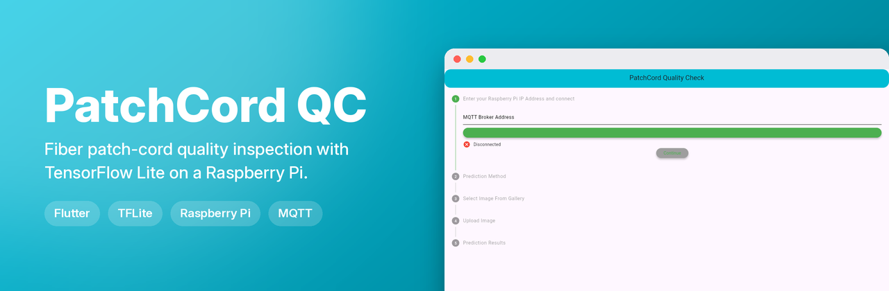
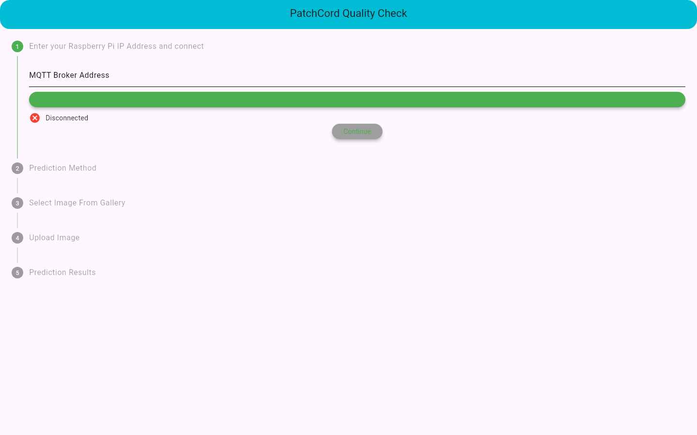
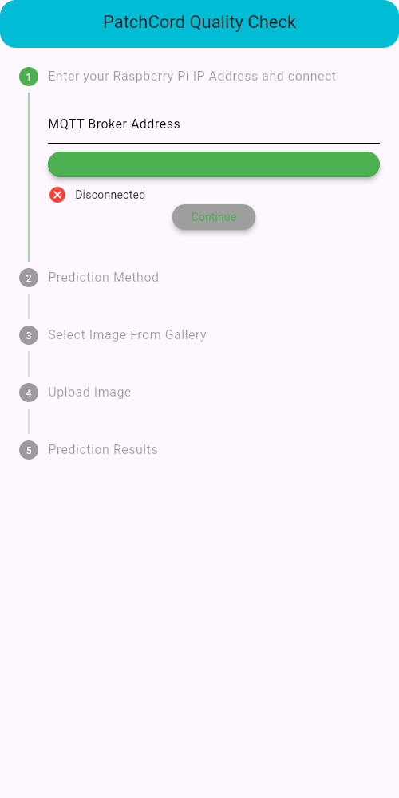

**▶ Live demo: [mohamedbenhmida-patchcord.web.app](https://mohamedbenhmida-patchcord.web.app)**

> The web demo shows the interface only: predictions need the Raspberry Pi and the MQTT broker.

<p align="center">
  
  
</p>

# PatchCord QC

Quality inspection for **fiber-optic patch cords**. The app connects to a Raspberry Pi over MQTT, sends a photo of the
connector and shows whether it passes, using a TensorFlow Lite model on the phone or an H5 model on the Pi.

## How it works

1. Enter the Raspberry Pi IP address and connect to the MQTT broker
2. Choose the prediction method: on-device **TensorFlow Lite** or the **Raspberry Pi H5** model
3. Pick an image from the gallery (or the camera)
4. Upload it
5. Read the prediction result

The app can also check for model updates.

## Tech

Flutter · GetX · Provider · TFLite · MQTT (mqtt_client) · Dio · image_picker

## Run it

```bash
flutter pub get
flutter run            # Android / iOS
flutter run -d chrome  # web
```
